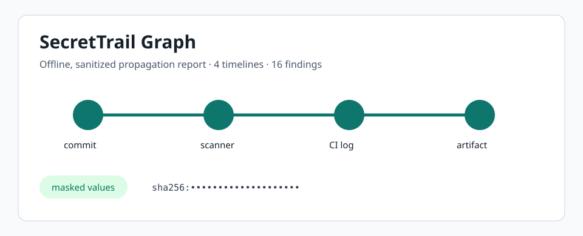

# SecretTrail Graph

[](https://github.com/KanadeK/secrettrail-graph/actions/workflows/ci.yml) [](LICENSE) [](https://github.com/KanadeK/secrettrail-graph/releases)

SecretTrail Graph turns appearances of the same secret in commits, CI logs, and artifacts into a privacy-preserving timeline so security teams can find a likely source and the full cleanup scope.



- Correlates Gitleaks, Trivy, Git-log JSON, and artifact manifests.
- Stores and exports only a SHA-256-derived fingerprint and masked fragment.
- Produces a portable offline HTML report with root-cause candidates and repair steps.

Status: `v0.1.0`. Public-repository sampling found no same-named, highly similar active project; see [the scan](docs/COMPETITOR_SCAN.md).

## Quick start

```bash
python -m pip install -e '.[dev]'
make demo
```

This produces `dist-release/demo-report.html` and `dist-release/demo-report.json`. Open the HTML file locally; it has no network dependency.

## Real input to real output

```bash
python -m leakloom.cli analyze \
  --gitleaks examples/gitleaks.json --trivy examples/trivy.json \
  --git-log examples/git-log.json --artifacts examples/artifacts.json \
  --workspace examples/current --html report.html --json report.json
```

The sample builds four propagation paths and identifies two recurrences. Removing all sample values from `examples/current/active.txt` and rerunning produces `resolved` timelines.

## Features and non-goals

SecretTrail Graph imports scanner output, groups occurrences by irreversible fingerprint, builds ordered propagation edges, and produces a concrete remediation checklist. It is an investigation and reporting tool, not a credential vault, a secret scanner replacement, or a history-rewriting utility.

## Architecture

The domain package is pure Python and uses NetworkX only to model propagation links. File parsers belong in `adapters`; `services` composes inputs; CLI and FastAPI are separate entry points. See [architecture](docs/ARCHITECTURE.md).

## Interface

The CLI is the primary offline interface. For automation, run `uvicorn leakloom.api:app` and POST `FindingInput` objects to `/api/analyze`; `/health` provides a simple liveness check.

## Sample data

The committed examples use deterministic `LLM_FAKE_` values invented for this repository. They are not credentials. Reports deliberately omit them, including from embedded page data.

## Privacy and security

Raw values are accepted at import time and immediately reduced to a SHA-256-derived identifier and masked display value. Do not treat that as a substitute for rotation or artifact retention controls. Read [privacy and security](docs/PRIVACY_AND_SECURITY.md) and [security policy](SECURITY.md).

## Testing and packaging

```bash
make verify
make demo
make package
make release-check
```

`make verify` runs linting, strict typing, coverage-enforced tests, and a Python build. `make package` creates wheel, source archive, sanitized report, and SHA256 manifest in `dist-release/`.

## Differentiation

Gitleaks and Trivy detect secrets. SecretTrail Graph consumes their JSON alongside repository and build evidence to model one credential's timeline, recurrence, remediation scope, and offline report. Details are in [COMPETITOR_SCAN.md](docs/COMPETITOR_SCAN.md).

## Roadmap and contributing

Next: richer native Git log extraction and signed report attestations. Contributions are welcome through [CONTRIBUTING.md](CONTRIBUTING.md); community expectations are in [CODE_OF_CONDUCT.md](CODE_OF_CONDUCT.md).

## FAQ

**Does it upload findings?** No. The included CLI operates on local files.

**Can it prove a source caused a later leak?** No. It provides an ordered root-cause candidate based on observed evidence.
